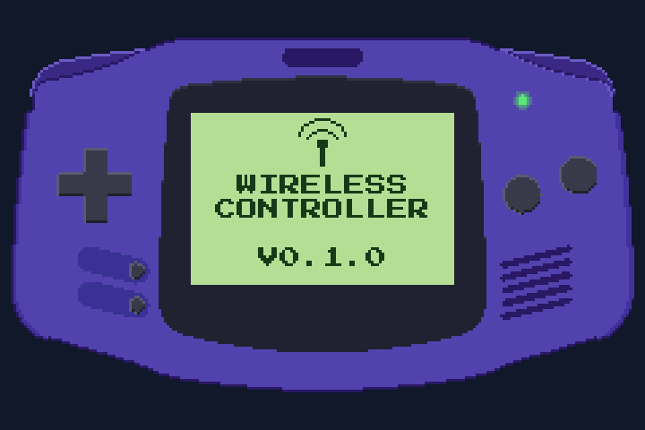
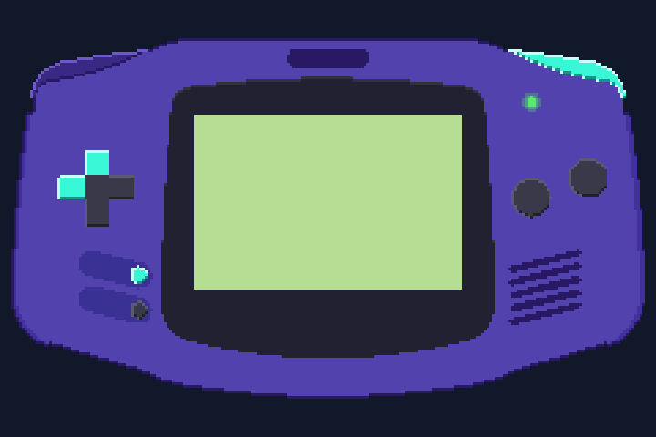
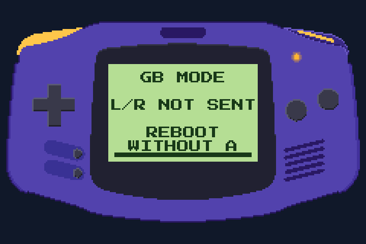
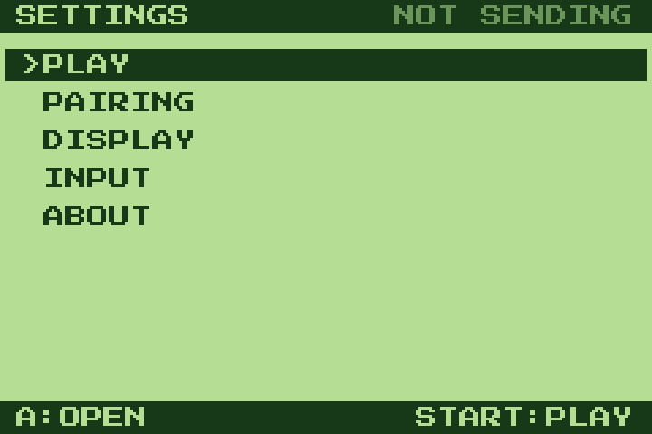
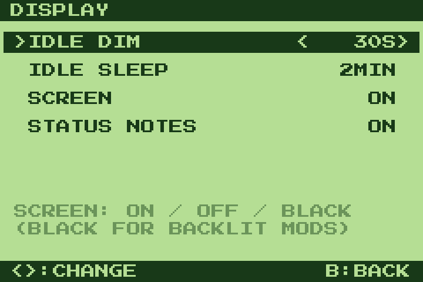
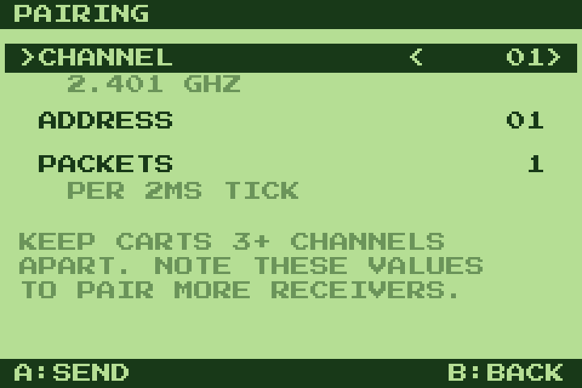
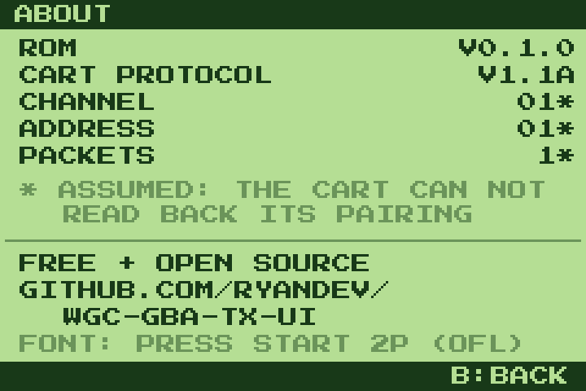

# wgc-gba-tx-ui

**A prettier screen for the insideGadgets Wireless Gameboy Controller.** The GBA TX cart turns a Game
Boy Advance into a wireless pad, but its screen is a plain text console. This replacement ROM shows a
live drawing of the console you're holding, with every button lighting up as you press it, a status
light that tells the truth about the link, and a proper Settings menu, while adding **no input
latency**. Unofficial; free and open source.

<p align="center"></p>

| | |
|:---:|:---:|
| <br>**Boot splash**: keys are live from the first frame; any press skips it | <br>**Live view**: every button lights as it's sent, then fades |
| <br>**Honest status**: GB mode says L/R aren't sent; the LED is amber | <br>**Settings**: hold L+R+Select and it zooms into the drawn screen |
| <br>**Settings home**: input to the game pauses while it's open | <br>**Display**: idle dim and sleep, screen off or black, notes |
| <br>**Pairing**: the same bytes as the stock ROM, nicer to set | <br>**About**: free and open source |

Every picture here is a **pixel-exact test**: the goldens in `tests/visual/golden/` are checked on each
push (regenerate these with `python3 tools/readme_images.py`). The drawing is traced from a 1:1 CAD
model of the console, rendered in the Press Start 2P font.

**What it does:** live controller view · status LED (green sending, amber caveat, red not sending) and
timed notes on the drawn screen · boot splash · Settings (hold L+R+Select for 1 s, or Start at boot) with
pairing, display options and GB mode · idle dim and sleep (any key wakes it and is still sent) · the
stock boot holds still work. **What it doesn't change:** the wireless protocol. The cart sees the same
bytes as with the stock ROM, every 2 ms, whatever is on screen (checked by the test suite against
recordings of the stock ROMs). **Status:** complete in the emulator; not yet tested on a real cart (see
*Where things stand*).

Repo: https://github.com/Ryandev/wgc-gba-tx-ui

## Controller: wireless GBA pad for the giant GBA

This is a sub-project of the giant GBA (see `../Claude/build-brief.md`). It uses the insideGadgets
**Wireless Gameboy Controller**: a **GBA TX cart** in a real GBA, plus a **USB receiver** that shows
up on the Pi 4 / RetroArch as a USB HID joystick.

**Goal:** replace the plain text-console UI on the cart with something more interesting, without
breaking the wireless link.

## Setup (a fresh machine)
Ubuntu 24.04 (native or WSL):
```
git clone https://github.com/Ryandev/wgc-gba-tx-ui.git && cd wgc-gba-tx-ui
bash scripts/setup_ubuntu.sh          # packages (sudo), pinned sources, first build, git hooks
bash scripts/setup_ubuntu.sh --check  # later: check a machine without changing it
make check                            # the full test suite
```
Why not devkitPro: its servers Cloudflare-block some networks, so the toolchain is Ubuntu's
`gcc-arm-none-eabi` + newlib, and libtonc / the GBA crt0 / gbafix are built from GitHub at pinned commits
(`scripts/fetch_deps.sh`). The stock ROMs for `make baselines` aren't in the repo (see FLASHING.md);
the recorded baselines are. Optional: `scripts/install_mull.sh` (Mull, not needed).

## Build
```
make                 # ROM for v1.1a carts -> build/wgc-gba-tx-ui.gba   (PROTOCOL=V11B for 2023+ carts)
make test            # headless mGBA: compare cart writes with the stock ROM recordings
make run             # open in mgba-qt
make unit            # host unit tests of src/core, both protocols
make coverage        # unit + gcovr gate (100% lines and branches), report in build/coverage.html
make visual          # golden-image tests (pixel-exact); make visual-approve SCREEN=a,b after looking
make mutate          # mutation testing on the real ARM build (slow)
make lint            # gcc -fanalyzer + clang-tidy + cppcheck
make check           # format-check + lint + coverage + protocol/timing + visual (CI + pre-push hook)
make hooks           # once per clone: pushes run `make check` first
```
Needs Ubuntu packages `gcc-arm-none-eabi binutils-arm-none-eabi libnewlib-arm-none-eabi build-essential git
python3-pil librsvg2-bin` (the last two generate the graphics and font)
(+ `libmgba-dev` for tests, `cppcheck clang-tidy clang-format gcovr` for lint and coverage, `mgba-qt` to play).
CI (`.github/workflows/ci.yml`) runs `make check` on every push and PR on Ubuntu 24.04. libtonc, the GBA crt0 and gbafix are fetched from
GitHub at pinned commits by `scripts/fetch_deps.sh`.

## Layout
| Path | What |
|---|---|
| `HARDWARE.md` | Everything known about the hardware, plus the reverse-engineered cart protocol. **Read before touching the ROM.** |
| `FLASHING.md` | The three programs in the system, how each is updated, and the step-by-step cart reflash |
| `reference/` | Vendor manual PDF, stock ROMs v1.1a/v1.1b (with SHA-256), board photos and rumble-mod schematic |
| `SPEC.md` | **What we're building**: features A–R, ground rules, phases 0–4, ruled-out ideas |
| `FEATURES.md` | Every stock screen (emulator screenshots), the verified byte log, and a feature menu for the new UI |
| `src/` | ROM hardware layer: `link_write.s` (bus-faithful cart write), `link.c` (2 ms timer IRQ), `main.c` (boot, screens), `screen_main.c` (controller view: drawing on BG2, buttons and LED lit by palette writes; splash, notes, Settings zoom), `screen_settings.c` (Settings pages on BG1) |
| `src/core/` | Pure logic, no hardware (host-tested): key packing and protocol bytes, boot holds, pairing menu, text, controller view (lighting, release fade, LED colours), LCD notes (timers, text and countdown bar canvas), boot splash (phases, skip), Settings (combo, pages, options), idle dim/sleep, zoom, generic 4bpp canvas (ARM, in IWRAM) |
| `tests/unit/` | Unity unit tests of `src/core`, run for both protocols (`make unit`, `make coverage`) |
| `tests/run_tests.py` | Regression test against the stock ROM's recorded cart writes |
| `tools/disasm_thumb.py` | Small Capstone disassembler used for the reverse engineering |
| `tools/emu_harness.c` | Headless mGBA runner: boot with keys held, script presses, dump frames and log cart writes. Build notes are at the top of the file. |
| `assets/controller.svg` | The controller drawing (source of truth for the ROM's graphics), generated by `tools/gen_controller_svg.py` from the owner's 1:1 GBA CAD |
| `assets/controller_cad.json` | Front-view outlines traced from the CAD's STEP parts by `tools/cad_trace.py` (run by hand in the CAD's cadquery env when the CAD changes) |
| `tools/svg_to_gba.py` | `controller.svg` → 8bpp affine background for the ROM (tiles, 32x32 map, one palette entry per part so a button lights with one palette write); built into `build/gen/` |
| `assets/fonts/` | Press Start 2P (SIL OFL 1.1, `OFL.txt`); `tools/ttf_to_tfont.py` turns it into the ROM's 8x8 glyphs at build time (`make tools-test` tests it) |
| `tools/gba_front_labels.py` | Old DXF route to the drawing, kept for reference only (the DXF's origin is unknown; superseded by `gen_controller_svg.py`) |
| `docs/images/`, `tools/readme_images.py` | The README's pictures: golden screenshots at 3x and an animated demo recorded in the emulator (re-run the tool when goldens change) |
| `tools/shots.py` | Screenshots on demand: captures, contact sheet, side by side with a mockup (runbook: `.claude/skills/screenshots/SKILL.md`) |
| `tools/ppm2png.py` | Converts harness frames to scaled PNGs (no dependencies) |

## Where things stand (parked 2026-11-15)

**Phase 1 is complete in the emulator** and pushed: the live controller view (CAD-traced, buttons lit,
release fade), status LED and LCD notes (GB mode note and strike), boot splash, Settings (hold L+R+Select
1 s, or Start at boot) with the zoom into the drawn LCD and the PAIRING / DISPLAY / INPUT / ABOUT pages,
display options, idle dim and sleep. Every chunk was reviewed by Gemini and mutation-tested.

- **Proven in mGBA:** cart writes and timing match the stock ROM byte for byte (14 scenarios x 2
  protocols, send gap 2.00 ms, press-to-send <= 2 ms, with the UI busy); 77 pixel-exact screenshots per
  protocol; unit tests at 100% line and branch coverage; mutation-tested.
- **Not proven yet:** anything on the real cart. Next milestone: **Phase 0.5** with a GBxCart RW v1.4
  (dump and keep the stock ROM, flash this one, check buttons through the receiver on the Pi).
- **Backlog:** every remaining phase and follow-up is a GitHub issue; `scripts/create_issues.sh` creates
  them (needs `gh`: `sudo apt install gh && gh auth login`, then `bash scripts/create_issues.sh`).
- **Screenshots:** `tools/shots.py` and the runbook in `.claude/skills/screenshots/SKILL.md` (recipes
  for every screen, comparing with mockups, golden-approval rules).

History: Phase 0 (protocol core, 2026-11-14) reproduced the stock v1.1a byte stream in all recorded
scenarios; the toolchain is Ubuntu `gcc-arm-none-eabi` + newlib with libtonc, devkitPro's crt0 and
linker script, and gbafix built from GitHub at pinned commits (devkitPro's servers block this network).

## The current UI (stock)
A libgba text console on a dark grey background: the "insideGadgets" title, a version line, and a
`.` that appears whenever a key is down. Holding Start at boot gives a 3-line Options menu. Nothing
else.
